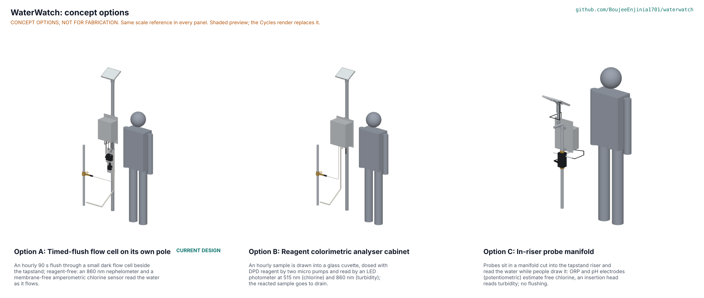

# WaterWatch concept options

Result: option A, the timed-flush flow cell on its own pole (the current design), scores 196 of 245; option B, a reagent colorimetric analyser cabinet, scores 167; option C, a probe manifold in the riser, scores 155. Option A was recommended and Amish chose it on 2026-10-25 (WWT-DDR-004). B is 15 % below A, outside the 10 % band that would send both to Amish without a pick. All three options are modelled to detail level D3 in `cad/src/model.py` ("Detail every option", Amish, 2026-10-24); the picture below is a shaded stand-in drawn from those models by `cad/src/options_preview.py`, which the Blender Cycles render (`python .kit/options.py`) replaces. Method: STANDARDS section 21.

## The options

### Option A: timed-flush flow cell on its own pole (current design)

Once an hour a latching valve on a tee in the tapstand riser opens for 90 s and flushes 0.75 L through a small, dark flow cell; an 860 nm nephelometer reads turbidity, a membrane-free graphite three-electrode sensor reads free chlorine amperometrically, and a probe reads temperature. The unit stands on its own galvanised pole beside the tapstand, with the electronics under a ventilated sun shield and a 5 W panel on top (WWT-PRC-001). It uses no reagent and leaves the tapstand unchanged but for one tee. Risks: the low-cost chlorine sensor's drift over a month (WWT-STM-001 S12, S14) and window fouling (S22). Needs from a partner: sites, pressure and pH surveys, a caretaker routine and a month of side-by-side DPD readings.

### Option B: reagent colorimetric analyser cabinet

The same pole, plumbing and power, but chlorine is measured by the reference chemistry: every hour a latching valve fills a 12 mm glass cuvette, the photometer reads turbidity at 860 nm and a blank at 515 nm, two small peristaltic pumps add DPD indicator and phosphate buffer, a magnetic stirrer mixes, and the photometer reads the magenta colour at 515 nm. The reacted sample drains through an air break to a soakaway. The analyser, two 80 mL reagent bottles, the battery and electronics share one larger IP66 cabinet (240 x 140 x 320 mm) under a sun shield. Accuracy no longer depends on electrode drift or pH, but the reagents must be resupplied, lose strength in a hot cabinet (B2) and leave a chemical drain (B5), and the pump tubing wears. Needs from a partner: a reagent supply chain and a place to discharge the reacted sample.

### Option C: in-riser probe manifold

A short length of the riser is replaced by a black PVC manifold between two brass unions. ORP and pH electrodes, a temperature probe and an insertion turbidity head sit in compression glands in its ports, and a paddle flow switch wakes the unit whenever someone draws water, so the probes read the water people actually take and no water is flushed. A small cabinet (160 x 90 x 190 mm) clamps to the riser behind the tapstand with two U-bolts, and the panel sits on a short mast bolted to its back plate. There is no pole, footing, valve or flow cell. But free chlorine is only estimated from ORP and pH (C1), the electrodes sit in the drinking water path with their glass and reference electrolyte, the riser must be cut, which the problem statement rules out (C6), and nothing is read at night when nobody draws water (C3). Needs from a partner: consent to modify the tapstand, and a pH and ORP calibration routine.

## First-order numbers

Table 1. Options compared at one tapstand (option A from WWT-CAL-001 and the priced BOM; B and C first-order estimates; models from `cad/fidelity.json`).

| Quantity | Option A | Option B | Option C |
| --- | --- | --- | --- |
| Estimated parts cost (USD) | 325 (priced BOM, indicative) | 380 to 450 (estimate, WWT-MKT-001; to assess) | 300 to 380 (estimate, WWT-MKT-001; to assess) |
| Energy (Wh/day, with 1.5 margin) | 0.54 (WWT-CAL-001 A3) | About 0.7 to 0.8 (WWT-STM-001 B4) | About 0.25 to 0.4 (WWT-STM-001 C5) |
| Water to drain (L/day, hourly) | 18.0 (19.8 at tolerance; 15.4 at a 0.5 bar site) | About 18, carrying reagent | None |
| Free chlorine method | Amperometric, membrane-free, calibrated monthly against DPD | DPD colorimetry, the reference method | ORP and pH, estimate only |
| Consumables | DPD tablets for the monthly check | Two reagents, pump tubing | Electrode replacement |
| Change to the tapstand | One saddle tee | One saddle tee | Riser cut, two unions |
| Moving parts | 1 (valve) | 4 (valve, two pumps, stirrer) | 1 (flow switch paddle) |
| Parts in the D3 model (with fasteners) | 215 | 173 | 139 |
| Mass of the D3 model (kg) | 19.2 | 18.8 | 6.4 |
| STEM check | Open: 28 within, 9 plausible; S31 (chlorine at 1.5 mg/L) closed by Amish's decisions O2 and O5 of 2026-10-25; S3 and four review items fixed (WWT-DEC-001 F1, F5 to F8) | Open: B2, B5 plausible | Open: C1, C4 plausible |

## Scoring

Table 2. Weighted scoring against the user requirements (WWT-URS-001; weights: High 3, Medium 2, Low 1; scores 1 to 5) and the kit's four further criteria.

| Criterion | Source | Weight | A | B | C | Reason |
| --- | --- | --- | --- | --- | --- | --- |
| Chlorine at the tap | UR-001 | 3 | 3 | 5 | 2 | B uses the reference DPD chemistry, independent of electrode drift; A's drift is unknown; C's ORP tracks chlorine only loosely |
| Cloudy water | UR-002 | 3 | 4 | 4 | 3 | A and B read a still sample after settling; C reads running water with bubbles |
| Alerts to the people who act | UR-003 | 3 | 4 | 4 | 3 | Same modem and SMS; C cannot read at night or when the tap is idle |
| Trends and records | UR-004 | 2 | 4 | 4 | 4 | Same data path |
| No mains power | UR-005 | 3 | 5 | 4 | 5 | B's pumps and stirrer add about a third to the energy |
| Outdoor site | UR-006 | 3 | 4 | 3 | 3 | B's reagents lose strength in a hot cabinet; C's glass electrodes are in the riser, exposed to knocks and water hammer |
| Supply kept clean | UR-007 | 3 | 4 | 3 | 2 | A: check valve and air break, no chemicals; B: reagents beside the sample line; C: electrodes and electrolyte inside the drinking water path |
| Little water used | UR-008 | 2 | 4 | 4 | 5 | C flushes nothing |
| Monthly caretaker check | UR-009 | 3 | 3 | 2 | 2 | A: 30 min, at the limit; B: reagent refills, tubing and cuvette cleaning; C: pH and ORP calibration and riser shut-off to reach the probes |
| Simple installation | UR-010 | 3 | 4 | 4 | 2 | C cuts the riser |
| Affordable per point | UR-011 | 3 | 4 | 2 | 3 | From Table 1, with B's running cost |
| Measurements, not verdicts | UR-012 | 3 | 5 | 5 | 5 | Same alert rule |
| Water temperature | UR-013 | 1 | 5 | 5 | 5 | Same probe |
| Open and reproducible | UR-014 | 2 | 4 | 3 | 4 | B depends on a reagent supply chain |
| Safe to handle | UR-015 | 3 | 4 | 3 | 4 | B adds reagent handling |
| Adjustable schedule | UR-016 | 1 | 4 | 4 | 2 | C reads only when water is drawn |
| Cost against the value-engineering target | | 2 | 4 | 2 | 3 | A is USD 25 over; B well over |
| Buildable with local skills and tools | | 2 | 4 | 2 | 3 | B needs a cuvette photometer and pumps assembled to tight tolerances; C needs a pipe cut and threaded |
| Safety | | 3 | 4 | 3 | 2 | As UR-007 and UR-015 |
| Maintenance | | 1 | 3 | 2 | 2 | As UR-009 |
| **Weighted total** | | | **196** | **167** | **155** | |

Weighted total = sum of score x weight over the 20 criteria (maximum 245). B is 85 % and C 79 % of A.

## Recommendation (decided by Amish, 2026-10-25)

- **Option A** is recommended. It is the only option that adds no chemical and no change to the tapstand beyond one tee, uses the least effort per visit of the two that read chlorine directly, and is already designed, calculated and drawn to TRL 3. Its weakness is the one B is strong in: whether its reagent-free chlorine reading holds for a month, and, after the independent review's corrected error budget, its accuracy at high residual (WWT-STM-001 S31), where B's buffered DPD chemistry does not depend on the site's pH.
- **Option B's best idea to graft onto A:** make the monthly reference more exact. A handheld DPD photometer per operator (for example the Hanna HI97711, USD 379.99, WWT-MKT-001) in place of the caretaker's colour comparator would cut the reference error, the largest single term in the chlorine error budget at low residual (±0.07 mg/L, WWT-CAL-001 E3), and give the drift test at TRL 4 a better yardstick. It is shared across sites, so it does not change the unit cost. Decided by Amish on 2026-10-25 (WWT-DDR-004, D2); with it and the restated PR-001 the budget meets all 8 cases (WWT-CAL-001 E12).
- **Option C's idea worth keeping:** a flow-triggered extra reading when people draw water, using a switch on the sample line, would tie readings to use; it is noted for TRL 4, not proposed now.
- **If the TRL 4 drift test fails** (S12), option B is the fallback: same pole, power and alerts, with the flow cell replaced by the cuvette analyser.

The precis (WWT-PRC-001) and every TRL 3 document describe option A. Options B and C stay in the model at D3 as alternatives (`components("B")`, `components("C")`; STEP in `cad/step/B-assembly.step` and `cad/step/C-assembly.step`).
